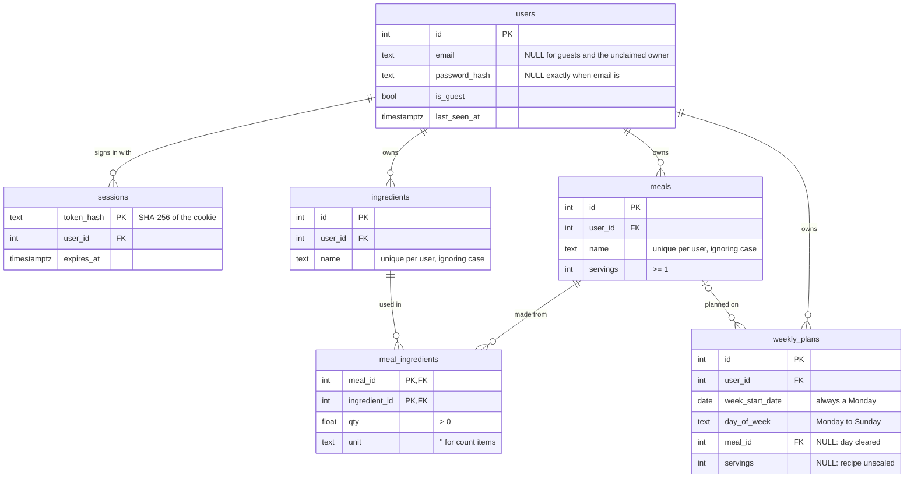

# Database schema

Six tables. Everything a person creates is owned by one row in `users`, and
deleting that row deletes everything it owns. The conventions behind the
names and constraints are in [conventions.md](conventions.md), and
`tests/test_conventions.py` checks them.

Every table also has `created_at` and `updated_at`, set by the database.

## Tables

**users.** One row per person. Three kinds, told apart by columns rather
than a type field: a *guest* (`is_guest`, no credentials) identified only by
a session cookie and removed after a period without a visit; an *account*
(email and password hash), which a guest becomes in place when signing up so
their data comes with them; and the *unclaimed owner* (neither), the single
account the accounts migration gave the data from before accounts existed,
which gains credentials when claimed. Check constraints keep these
consistent: an email always has a password hash and vice versa, and a guest
never has an email. Emails are unique ignoring case.

**sessions.** A signed-in browser. The cookie holds a random token and the
table holds only its SHA-256, so a copy of the table cannot be replayed as
live sessions. Indexed by `expires_at` for cleanup.

**meals.** A recipe and the servings it yields. A name is unique per person,
ignoring case: two people can both have "Spaghetti Bolognese", one person
cannot have it twice. The unique index's leading column, `user_id`, also
serves every lookup by owner.

**ingredients.** The items in one person's kitchen, shared by their meals.
Per person rather than global, so one person's spelling never becomes
everyone's and the autocomplete never suggests a stranger's ingredient.

**meal_ingredients.** How much of an ingredient a meal uses. `qty` is
positive; `unit` is empty for count items ("2 onions").

**weekly_plans.** The meal on one day of one week for one person, unique on
`(user_id, week_start_date, day_of_week)`. A row with no meal is a day
deliberately cleared, which is different from a day never set (no row).
`servings` NULL means cook the recipe as written.

## What happens on delete

| Deleting | Effect | Why |
|---|---|---|
| a user | their sessions, meals, ingredients and plans go too (`CASCADE`) | nothing a person owns outlives them |
| a meal | its ingredient lines go (`CASCADE`); days it was planned on stay, cleared (`SET NULL`) | a plan for a week is still the week's plan with one day emptied |
| an ingredient still on a meal | refused (`NO ACTION`) | the meal would silently lose a line |

The last is `NO ACTION` rather than `RESTRICT` on purpose. `RESTRICT` is
checked the moment a row is deleted, so deleting a user - which removes
their meals and their ingredients in whatever order the database chooses -
failed on SQLite whenever the ingredients went first. `NO ACTION` is
checked at the end of the statement, by which time the meal lines are gone
as well. A test deletes a user with a full set of data to prove it.

## What the database does not enforce

A plan's `meal_id` must belong to the same person as the plan, and a meal's
ingredients must belong to the same person as the meal. A foreign key checks
only that the row exists, not who owns it. Enforcing ownership in the
database would need composite foreign keys such as `(user_id, meal_id)`, and
`ON DELETE SET NULL` on one of those would also null `user_id` unless the
database supports a column list (Postgres 15+; SQLite does not). So the
repositories check ownership on every write, tests prove it, and row-level
security in Postgres (Phase 1) enforces it again for reads and writes.
